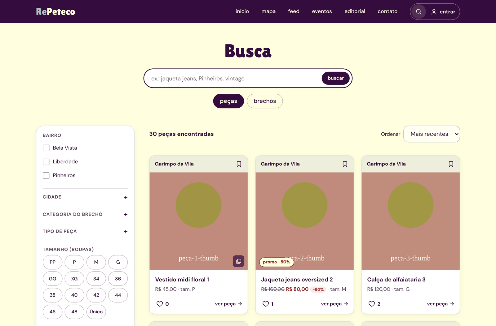
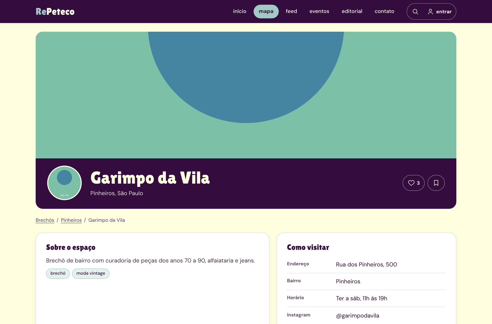
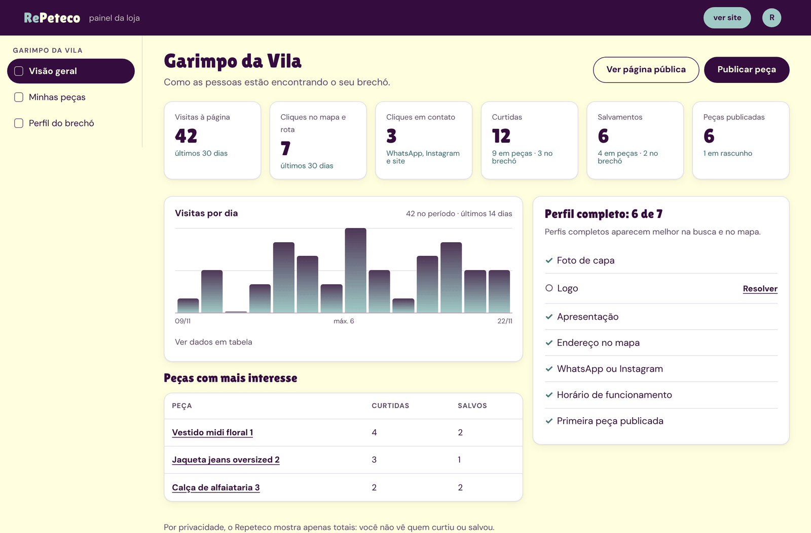
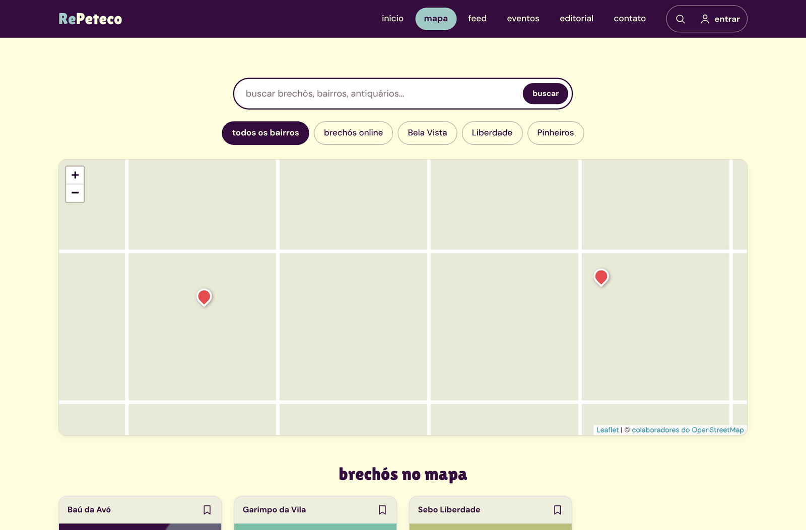

# Repeteco — brechós de São Paulo

**Repeteco** é uma plataforma para encontrar brechós, sebos e antiquários de São Paulo. Ela reúne num só lugar o mapa das lojas, as peças à venda e um painel para quem administra um brechó.

🔗 **Site:** [repeteco-kappa.vercel.app](https://repeteco-kappa.vercel.app)

<p>
  
</p>

## O problema

Quem gosta de comprar em brechó encontra as informações espalhadas: um endereço no Instagram, o horário num guia antigo, as peças só em stories que somem em 24 horas. Já os brechós pequenos têm pouca visibilidade e quase nenhum dado sobre quem se interessa pelo que eles vendem.

## A proposta

Uma plataforma com três experiências:

- **Quem visita:** feed de peças, busca com filtros (bairro, categoria, tipo de peça, tamanho e numeração), brechós no mapa com "aberto agora", editorial, eventos, curtidas, peças salvas e perfil.
- **Dono de brechó:** cadastro com aprovação, publicação de peças com várias fotos (recorte e compressão no navegador), promoções, perfil da loja com mapa e um painel com visitas, cliques e interesse por peça.
- **Administração:** aprovação de brechós, moderação de peças, gestão de pessoas, editorial, eventos e parcerias, mensagens e indicadores.

| Página do brechó | Painel do dono |
|---|---|
|  |  |

| Brechós no mapa |
|---|
|  |

> As imagens foram geradas com os **dados de demonstração dos testes automatizados** (brechós, pessoas e peças fictícios). As fotos das peças aparecem como formas geométricas porque, nos testes, as imagens são substituídas por marcadores, e o mapa usa um fundo simulado.

## Tecnologias

| Camada | Tecnologia |
|---|---|
| Interface | HTML, CSS e JavaScript puro, sem framework e sem etapa de build |
| Back-end | [Supabase](https://supabase.com): Auth, PostgreSQL com Row Level Security, Storage |
| Banco | SQL: tabelas, views, funções, gatilhos e políticas de acesso, em versões idempotentes |
| Mapa | Leaflet + OpenStreetMap |
| Hospedagem | Vercel (site estático + funções serverless em `api/`) |
| Qualidade | ESLint, Playwright, axe-core, `node:test`, testes SQL em Postgres, GitHub Actions |

## Destaques técnicos

- **Segurança no banco de dados:** como não há servidor próprio, as permissões ficam no Postgres. Políticas de RLS e gatilhos impedem que alguém vire administrador, aprove o próprio brechó ou leia dados privados. Há testes que tentam essas ações e confirmam o bloqueio.
- **Privacidade:** o dono do brechó vê só totais de curtidas e salvamentos, nunca quem curtiu. As métricas de visitas são opcionais, não usam cookies e respeitam "Do Not Track".
- **Acessibilidade:** testes automáticos com axe-core (WCAG 2.1 AA), navegação por teclado, foco visível e layout de 375 a 1920 px.
- **Proteções extras:** Content-Security-Policy, limite de envios nos formulários (anti-spam) e testes de XSS.
- **Evolução sem perder dados:** o banco cresceu da v4 à v11 em scripts que podem ser rodados de novo sem efeito colateral, testados também em bancos antigos.

Mais detalhes em [docs/ARQUITETURA.md](docs/ARQUITETURA.md).

## Como rodar

```bash
npm ci
npm run serve        # http://127.0.0.1:8090
```

O site usa o Supabase configurado em `assets/js/config.js` (URL e chave *publishable*, que é pública por natureza: o acesso é controlado pelo RLS). Para montar o seu próprio banco, siga [docs/CONFIGURACAO.md](docs/CONFIGURACAO.md).

## Testes

```bash
npm test             # lint, funções da Vercel e testes de navegador (com o servidor rodando)
npm run test:db      # regras de acesso do banco (requer PostgreSQL local)
```

O GitHub Actions roda tudo a cada push e pull request. Detalhes em [docs/TESTES.md](docs/TESTES.md).

## Documentação

| Documento | Conteúdo |
|---|---|
| [docs/ARQUITETURA.md](docs/ARQUITETURA.md) | Como as partes se conectam e a organização das pastas |
| [docs/CONFIGURACAO.md](docs/CONFIGURACAO.md) | Supabase passo a passo, funções da Vercel, métricas e checklist antes de lançar |
| [docs/TESTES.md](docs/TESTES.md) | Como rodar o site localmente e cada suíte de testes |
| [docs/AUDITORIA.md](docs/AUDITORIA.md) | Falhas de segurança encontradas na versão anterior e como foram corrigidas |

## Limitações e próximos passos

- Os textos de `termos.html` e `privacidade.html` ainda precisam de revisão jurídica.
- A Content-Security-Policy está em modo de observação (*Report-Only*) e ainda não bloqueia nada.
- Falta o `sitemap.xml` com o domínio definitivo e a personalização dos e-mails do Supabase Auth.
- A carga inicial traz 13 brechós reais montados com informações públicas. Antes de um lançamento oficial, cada brechó deve ser avisado.

## Como este projeto foi feito

O Repeteco é o **Trabalho de Conclusão de Curso (TCC)** do curso Técnico em Informática para Internet da ETEC, desenvolvido **em grupo**. O projeto como um todo é do grupo.

**A criação e o desenvolvimento do site foram feitos por mim, individualmente.**

Para desenvolver o site, usei o **Claude (IA da Anthropic)** como ferramenta de programação. Isso aparece no histórico do Git, onde a maior parte dos commits tem o Claude como autor ou coautor.
